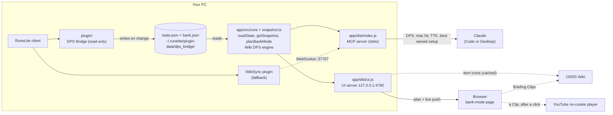

# OSRS PvM Coach

[](https://github.com/TomsoucAI/osrs-pvm-coach/actions/workflows/ci.yml)

## What it does

A read-only RuneLite plugin exports your live gear, levels, prayers, target, inventory and bank to local JSON files.
A Node core reads those files and calculates DPS with the **OSRS Wiki DPS calculator engine** (`weirdgloop/osrs-dps-calc`), including the best setup you own for a boss.
Two front ends share that core: an MCP server for Claude (Code or Desktop) and a local bank-mode web page.

## Architecture



| Folder | What it is | Language |
|---|---|---|
| `plugin/` | DPS Bridge RuneLite plugin. Reads game state, writes the two JSON files. No other output. | Java 11 (build with JDK 21) |
| `app/src/core/` | Shared core: reads both files (`liveState.ts`) and ranks owned setups (`bankMode.ts`) | TypeScript |
| `app/src/snapshot.ts`, `app/src/calc.ts` | State reader for the first four MCP tools (with the WikiSync fallback), and the engine wrapper | TypeScript |
| `app/src/index.ts` | `mcp` entry point: the MCP tools below | TypeScript |
| `app/src/ui.ts`, `app/src/ui/`, `app/page/` | `ui` entry point: HTTP server and the React page | TypeScript |
| `app/dist/` | Built, self-contained bundles. Committed, so users run them with no `npm install` | JavaScript |
| `app/fixtures/` | Sample plugin files for work without the game | JSON |

MCP tools:

| Tool | What it does |
|---|---|
| `osrs_get_loadout` | Live gear, levels (boosted/real), prayers, style, target |
| `osrs_calculate_dps` | DPS, max hit, accuracy, avg TTK vs current target or any monster. Optional overrides: `prayers`, `potions`, `style`, `spell`, `on_slayer_task`, `equipment` swaps, `defence_reductions` (DWH, Elder maul, BGS damage, Arclight, Emberlight, Accursed, Vulnerability) |
| `osrs_compare_setups` | Up to 10 variants vs one monster, sorted by DPS (live setup always included). Variants can carry their own `defence_reductions` |
| `osrs_best_owned_setup` | Best setups you **own** (worn gear, inventory, last bank snapshot) vs one monster, per combat style |
| `osrs_search_monsters` | Find exact monster name/version/id |

The UI server binds `127.0.0.1` only and has read-only endpoints. It answers a request only when `Host` is its own address and `Origin`, when the browser sends one, is its own origin (scheme, host and port). **Threat model:** this guard protects against websites, not against local programs. A local program can forge both headers, and it can read `state.json` and `bank.json` from disk with no server at all.

Known limits:

- The autocast spell isn't read from the game: pass `spell` for standard staves (powered staves are automatic).
- Special attack hits and ToA/CoX scaling inputs aren't exposed yet; the engine supports them. Defence drains from specs are supported (`defence_reductions`).
- Soulreaper axe stacks default to 5 (Wiki calc default).

## Legality rules and the never list

A plugin that breaks Jagex's or RuneLite's rules can get its users banned. Read this before you change anything.

<!-- never-list: keep this block identical in README.md and AGENTS.md -->
The plugin reads game state and writes local files. The app reads those files and answers questions before a trip. Never build any of these:

1. **No game input.** No code sends clicks, key presses, mouse moves, menu actions or camera moves to the game client.
2. **No modified client.** Run the official RuneLite client or its developer client (`gradlew run`). Never an injected, patched or third-party client.
3. **No HTTP from the plugin.** The plugin opens no socket and no server, and calls no URL. Its only output is files under `~/.runelite/plugin-data/dps_bridge/`.
4. **No in-fight prayer, attack or position prompts.** Nothing tells the player what to pray, what to attack or where to stand during a fight. The allowed output is planning: gear, DPS, a defence number.
5. **No Computer Use.** No agent reads the screen or drives the game window, keyboard or mouse. Agents get game data from the plugin's files and the MCP tools only.
<!-- /never-list -->

Two layers enforce the rules, because legality is about what a feature *does*, and code patterns only catch the obvious cases:

| Layer | When | What |
|---|---|---|
| Maintainer verdict (`osrs-legality-gate` skill) | Before any new or changed plugin feature, recorded on the issue | GREEN / AMBER / RED verdict against RuneLite's official rules and Plugin Hub precedent. RED features are refused |
| [`plugin/tools/legal-lint.mjs`](plugin/tools/legal-lint.mjs) | After every edit (Claude Code hook, with Claude Code opened at the repo root), in CI on every PR, or `node tools/legal-lint.mjs` in `plugin/` | RED: forbidden code (input injection, menu actions, autotype, reflection, servers…). The hook reports it to Claude after the edit; CI fails the PR. AMBER: risky APIs (projectiles, prayer tab, NPC targeting, sounds…) need a `// legal-gate: GREEN <reason>` line |

[`plugin/AGENTS.md`](plugin/AGENTS.md) is RuneLite's official agent guide (copied from `runelite/example-plugin`, imported by `plugin/CLAUDE.md`): Java 11, Filepath for file I/O, combat restrictions. No tool guarantees anything: the Plugin Hub review is the strongest check there is. If a feature wouldn't pass it, don't run it locally either.

### Account safety

- Nothing here asks for, reads or stores your password. The MCP makes no internet requests: it reads local files and WikiSync on localhost. The UI server makes one kind: it fetches item icons from the OSRS Wiki and keeps them on disk. Claude gets the answers that the MCP returns.
- The browser, not our code, loads the Briefing's Clips: videos from the OSRS Wiki; for a YouTube Clip, its thumbnail from YouTube's image host, then YouTube's no-cookie player only after you click it. The page's security headers allow these hosts and no others. The page sends no referrer; only the YouTube frame sends the page's origin, because the player refuses to play without one.
- Dev client login goes through Jagex's own login window. The session is stored encrypted in `~/.runelite/jagex-accounts.dat`; the key is in Windows Credential Manager. No password is stored.
- If you ever created `~/.runelite/credentials.properties` (old login method), delete it.
- The repo-root `.claude/settings.json` denies Claude Code's `Read` and `Edit` of `credentials.properties` and `jagex-accounts.dat`. This also blocks Bash commands that name the file (`cat`, `head`, redirections). **Residual risk:** it does not block a command that reads the file without naming it (`grep -r`) or a subprocess (`node -e`, `sh -c`). Only the Claude Code sandbox closes that gap, and it does not run on native Windows (WSL2 only). A read gives an encrypted session, not your password. Accepted for now; see #30.
- `install.mjs` installs no third-party skills or MCP servers. Don't add other people's MCP servers, skills or "RuneLite" downloads without reading them: they run with your user's permissions.
- Turn on 2-step authentication on your Jagex account.

## Setup on Windows

Prerequisites: git, Node 20.3 or later, and JDK 21 for the plugin. Reopen the terminal after you install them.

```powershell
winget install --id Git.Git --exact
```

```powershell
winget install --id OpenJS.NodeJS.LTS --exact
```

```powershell
winget install --id EclipseAdoptium.Temurin.21.JDK --exact
```

Clone the repo:

```powershell
git clone https://github.com/TomsoucAI/osrs-pvm-coach.git
```

```powershell
cd osrs-pvm-coach
```

Register the MCP server with Claude Code (user scope) and Claude Desktop. `--dry-run` shows what it would do first:

```powershell
node install.mjs --dry-run
```

```powershell
node install.mjs
```

Then fully quit Claude Desktop (tray icon → Quit) and reopen it. Ask Claude "What's my DPS on what I'm fighting?" or "What's the best melee setup I own for Vorkath?".

**The plugin** is not on the Plugin Hub yet, so it runs only in RuneLite's developer client. The first run downloads Gradle and RuneLite (2–5 min):

```powershell
cd plugin; .\gradlew.bat run
```

In the developer client: sidebar → Jagex auth panel → *Add Jagex Account* → log in → pick your character → *Play Now*. Then wrench (Configuration) → search **DPS Bridge** → turn it on. [TESTING.md](TESTING.md) has the in-game checks, level by level.

**No Java?** Install **WikiSync** from the RuneLite Plugin Hub instead. The MCP reads your gear and base levels from it. WikiSync doesn't expose boosts, prayers, style, target or bank, so pass them in the prompt ("with Piety and super combat, on Vorkath").

## Fixtures vs live

Every entry point reads the plugin's files. **Live** is the default: `%USERPROFILE%\.runelite\plugin-data\dps_bridge\state.json` and `bank.json` next to it. **Fixtures** are sample files in the same format, so you can work with no game login.

| Fixture | Contents |
|---|---|
| `app/fixtures/ironman-v2/` | Sample ironman: state, bank, rune pouch, spellbook. `reference-dps.json` holds the Wiki-calculator numbers the tests pin |
| `app/fixtures/oracle-small/` | Small bank for the brute-force optimizer test |
| `app/fixtures/spec-drains/` | State with counted DWH / Elder maul / BGS drains on a target |
| `app/fixtures/logged-out/` | Logged-out state (v1) |
| `examples/state.sample.json` | Original v1 state (no bank), used by the smoke test |

Run these from the repo root.

**Bank-mode page on a fixture**, then open `http://127.0.0.1:4780/` (`--port <n>` changes the port; Ctrl+C stops it):

```powershell
node app/dist/ui.js --fixture app/fixtures/ironman-v2
```

**What the MCP sees, on a fixture** (prints gear, levels, bank and DPS):

```powershell
node app/dist/inspect.js --file app/fixtures/ironman-v2/state.json
```

**The MCP server on a fixture.** It talks over stdio, so it prints one line and waits for a client; Ctrl+C stops it. `DPS_BRIDGE_FILE` picks the state file, and `bank.json` is read from the same folder:

```powershell
$env:DPS_BRIDGE_FILE = "$PWD\app\fixtures\ironman-v2\state.json"; node app/dist/index.js
```

To ask Claude Code questions against the fixture, register it under a second name in this folder only (`claude mcp remove osrs-dps-fixture` undoes it):

```powershell
claude mcp add osrs-dps-fixture -e DPS_BRIDGE_FILE="$PWD\app\fixtures\ironman-v2\state.json" -- node "$PWD\app\dist\index.js"
```

**Live:** the same commands without the fixture. Start the plugin first (`.\gradlew.bat run` in `plugin/`). Run `Remove-Item Env:DPS_BRIDGE_FILE` first if you set it in this terminal.

```powershell
node app/dist/ui.js
```

```powershell
node app/dist/inspect.js --watch
```

## Workflow

- **Issues.** Bugs, ideas and specs live in [GitHub Issues](https://github.com/TomsoucAI/osrs-pvm-coach/issues). Labels: `needs-triage`, `needs-info`, `ready-for-agent`, `ready-for-human`, `wontfix` ([docs/agents/triage-labels.md](docs/agents/triage-labels.md)).
- **Specs.** A feature starts as a spec issue (for example #1, Bank mode) with user stories, decisions, test seams and out-of-scope items. It is sliced into ticket issues, each with acceptance criteria and an **Owner verifies:** line for the check that only a human can do (often in game). A plugin ticket carries its legality verdict before any code.
- **Pull requests.** Branch from `main`, one ticket per PR, squash-merged. Nobody pushes to `main`. If you change `app/src/`, commit the rebuilt `app/dist/` (`npm test` rebuilds it). Details: [CONTRIBUTING.md](CONTRIBUTING.md).
- **CI** ([`.github/workflows/ci.yml`](.github/workflows/ci.yml)) runs on every PR, and all three jobs must pass before a merge: `legal-lint`, the app (`npm ci`, `npm run setup` clones the engine at the pinned commit, `npm test`), and the plugin Gradle build.
- **Security problems:** do not open a public issue; see [SECURITY.md](SECURITY.md).

Checks to run locally (in `app/`, after `npm ci` and `npm run setup`):

| Check | Command (in `app/`) |
|---|---|
| Rebuild from source + all tests (selftest, core, UI server, MCP smoke) | `npm test` |
| MCP smoke test only, on the prebuilt `dist/` | `npm run smoke` |
| Strict type-check of our code | `npx tsc -p .` (errors listed under `../vendor/` are the Wiki calc's own, unchanged) |
| Interactive explorer | `npx @modelcontextprotocol/inspector node dist/index.js` |
| Pull the latest engine + data and rebuild | `npm run update-calc` |
| LLM evaluation (optional: 10 questions, needs Python 3 and `ANTHROPIC_API_KEY`) | `cd ../evals; pip install -r requirements.txt; python evaluation.py evaluation.xml -t stdio -c node -a ../app/dist/index.js -e DPS_BRIDGE_FILE=../examples/state.sample.json` |

Plugin checks (in `plugin/`): `.\gradlew.bat build` and `node tools/legal-lint.mjs` (no RED).

## Licences

- `app/` (MCP server, UI server, page): GPL-3.0, see [`app/LICENSE`](app/LICENSE). It bundles the calculator engine (weirdgloop/osrs-dps-calc), which is GPL-3.0, so the bundled `dist/` is GPL-3.0 too.
- `plugin/` (RuneLite plugin): BSD-2, see [`plugin/LICENSE`](plugin/LICENSE). The Plugin Hub requires a permissive licence.

Credits: DPS maths from the [OSRS Wiki DPS calculator](https://github.com/weirdgloop/osrs-dps-calc). Built on [RuneLite](https://github.com/runelite/runelite). Fallback data: WikiSync. Not affiliated with Jagex, RuneLite or the OSRS Wiki.
